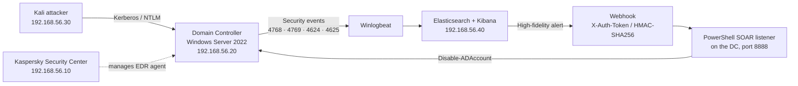

# EDR Blind Spot: Detecting & Responding to Active Directory Identity Attacks

> **An EDR blocked 6/6 host-based attacks, and saw 0/4 identity attacks.**
> This project closes that gap with an Elastic SIEM detection layer and a custom, guard-railed SOAR response.


Built as my final-year engineering project (cybersecurity internship, 2026) for a national critical-infrastructure operator. Everything here runs in an **isolated 4-VM lab**; no client data is included.

---

## The problem

EDR agents live on the endpoint. They are excellent at catching malicious binaries, code injection and known offensive tooling. But identity attacks against Active Directory **abuse legitimate Kerberos exchanges** and never drop anything on the target machine, so the EDR has nothing to see.

I reproduced the client's EDR deployment in a lab and ran **10 MITRE ATT&CK scenarios** against it:

| # | Scenario | MITRE technique | EDR alone | EDR + SIEM/SOAR |
|---|---|---|---|---|
| 1 | EICAR test file | Test | ✅ Blocked | ✅ |
| 2 | AMSI test | T1059.001 | ✅ Blocked | ✅ |
| 3 | Mimikatz | T1003.001 | ✅ Blocked | ✅ |
| 4 | Meterpreter | T1204 / T1055 | ✅ Blocked | ✅ |
| 5 | PsExec | T1021.002 / T1569.002 | ✅ Blocked | ✅ |
| 6 | NetExec | T1570 / T1059 | ✅ Blocked | ✅ |
| 7 | **Domain account enumeration** | T1087.002 | ❌ Silent | ✅ Detected |
| 8 | **Password spraying** | T1110.003 | ❌ Silent | ✅ Detected |
| 9 | **AS-REP Roasting** | T1558.004 | ❌ Silent | ✅ Detected + auto-response |
| 10 | **Kerberoasting** | T1558.003 | ❌ Silent | ✅ Detected + auto-response |

## The solution



1. **Collect**: Winlogbeat ships Windows Security logs from the domain controller to Elasticsearch.
2. **Detect**: 4 Kibana detection rules (run every minute, severity High, mapped to MITRE ATT&CK).
3. **Deceive**: a honeypot service account (`svc_sqladmin`) with an attractive SPN. Nothing legitimate ever requests a ticket for it, so **any** request is malicious: zero false positives.
4. **Respond**: high-fidelity alerts call a webhook; a PowerShell listener disables the compromised account **within seconds**, behind 4 guardrails.

## Detection rules

| Rule | Type | Logic | MITRE |
|---|---|---|---|
| [AS-REP Roasting](detection-rules/kibana/asrep-roasting.json) | Query | Event 4768 with `PreAuthType = 0` | T1558.004 |
| [Kerberoasting](detection-rules/kibana/kerberoasting-rc4.json) | Query | Event 4769 with RC4 encryption (`0x17`) | T1558.003 |
| [Password spraying](detection-rules/kibana/password-spraying-threshold.json) | Threshold | Network logons (4624, type 3) on **≥ 3 distinct accounts** from one source IP | T1110.003 |
| [Honeypot account](detection-rules/kibana/honeypot-svc-sqladmin.json) | Query | Event 4769 for `svc_sqladmin` | T1558.003 |

Details and design notes: [`detection-rules/README.md`](detection-rules/README.md).
Bonus: the same logic translated to **Microsoft Sentinel KQL** in [`detection-rules/sentinel/`](detection-rules/sentinel/).

## Automated response (SOAR) and its guardrails

A naive auto-disable is dangerous: an attacker could trigger it on purpose to lock out legitimate users. The listener therefore enforces:

| Guardrail | What it does | Lab test result |
|---|---|---|
| **Authentication** | Rejects any request without a valid HMAC-SHA256 signature or shared token | `REJECTED` |
| **Protect-list** | Never disables critical accounts (`Administrator`, `krbtgt`, admin accounts), even with a valid request | `BLOCKED` |
| **Idempotency** | Re-sending the same request has no side effect | `IGNORED` |
| **Audit log** | Every decision is timestamped in `C:\soar-actions.log` | 4 log lines, in order |

**Design choice:** the response is only wired to **high-fidelity rules** (AS-REP Roasting, Kerberoasting, honeypot), never to the threshold-based spraying rule, which can produce false positives.

Code and setup: [`soar/`](soar/).

## Results

| Capability | EDR alone | EDR + SIEM/SOAR |
|---|---|---|
| Host-based attacks | Detected (6/6) | Detected (6/6) |
| Identity attacks | **None (0/4)** | **All (4/4)** |
| Kerberos visibility | None | Full |
| Automated response | None | Account disabled |
| Reaction time | n/a | Seconds |

**Takeaway:** EDR and SIEM/SOAR are complementary, not interchangeable. The EDR protects the endpoint; the SIEM correlates identity events across the domain; the SOAR makes the response fast.

## Repository structure

```
├── README.md
├── docs/
│   ├── lab-setup.md            # 4-VM architecture, network, versions
│   ├── attack-scenarios.md     # the 10 scenarios and how each was run
│   └── lessons-learned.md      # real problems hit during the build
├── detection-rules/
│   ├── kibana/                 # Kibana detection rules (JSON)
│   └── sentinel/               # Microsoft Sentinel KQL translations
├── config/                     # docker-compose, kibana.yml, winlogbeat.yml
├── soar/                       # PowerShell listener, guardrail tests, Kibana connector
└── scripts/
    └── New-HoneypotAccount.ps1
```

## Reproduce it

1. Build the lab described in [`docs/lab-setup.md`](docs/lab-setup.md) (VirtualBox, host-only network `192.168.56.0/24`).
2. Start Elastic with [`config/docker-compose.yml`](config/docker-compose.yml) and install Winlogbeat on the DC with [`config/winlogbeat.yml`](config/winlogbeat.yml).
3. Import the rules from [`detection-rules/kibana/`](detection-rules/kibana/).
4. Create the honeypot account with [`scripts/New-HoneypotAccount.ps1`](scripts/New-HoneypotAccount.ps1).
5. Run the SOAR listener and wire the Kibana webhook as described in [`soar/README.md`](soar/README.md).
6. Replay the attacks from [`docs/attack-scenarios.md`](docs/attack-scenarios.md).

## Limitations and next steps

- A lab does not reproduce production log volume; thresholds and false-positive rates must be tuned on real data.
- Automated account disabling carries operational risk: roll out in **alert-only mode first**, then action mode.
- Next: Golden Ticket, DCSync and delegation abuse detections; threat-intel enrichment; a market SOAR engine; infrastructure-as-code deployment.

## Recommendations (from the project)

- Keep the EDR as the endpoint's first line of defence, without expecting it to cover identity.
- Centralise domain-controller security logs and apply Kerberos detection rules.
- Deploy SPN-bearing honeypot accounts as high-fidelity Kerberoasting detectors.
- Strictly guardrail any automated response before production.
- Enforce strong service-account passwords and Kerberos pre-authentication on every account.

## Disclaimer

For **educational and defensive purposes only**, in an isolated lab. Attack commands target a lab domain (`lab.local`) I built myself. Do not run them against systems you do not own or are not authorised to test.

## Author

**Ayoub Bakhii**, SOC Analyst · CompTIA Security+ · Microsoft SC-200
[LinkedIn](https://linkedin.com/in/ayoub-bakhii)
